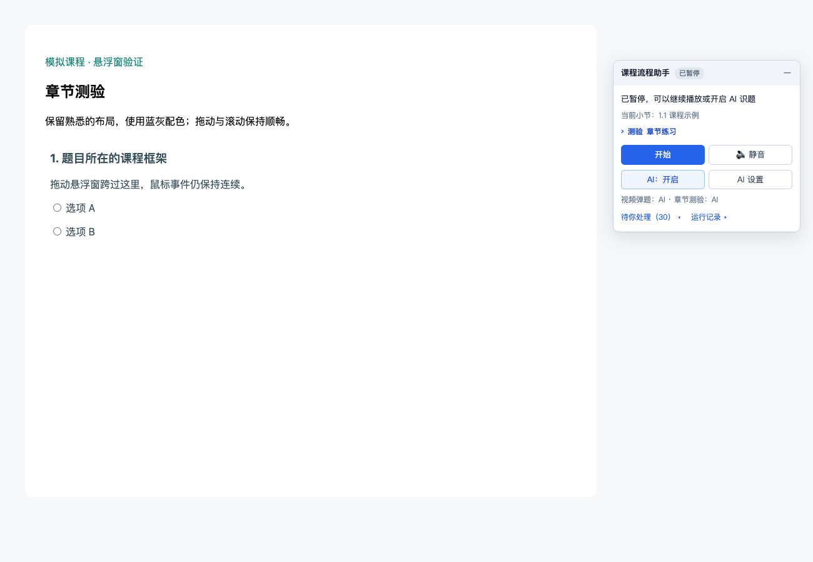
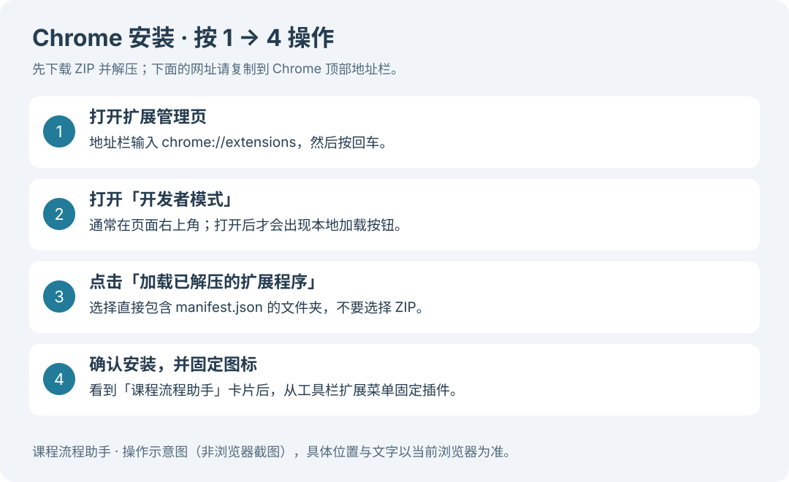
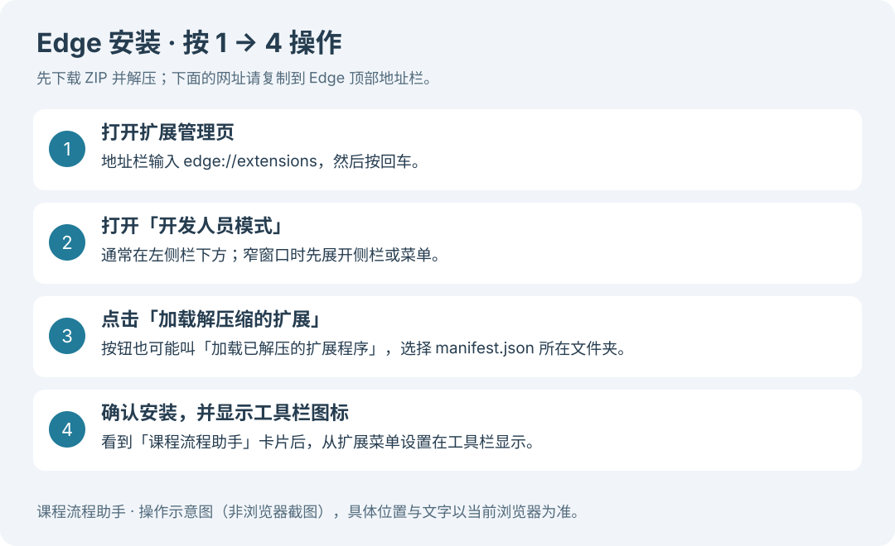
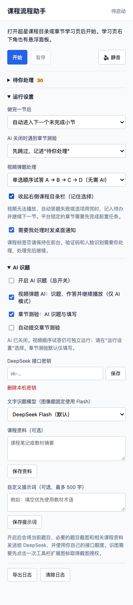
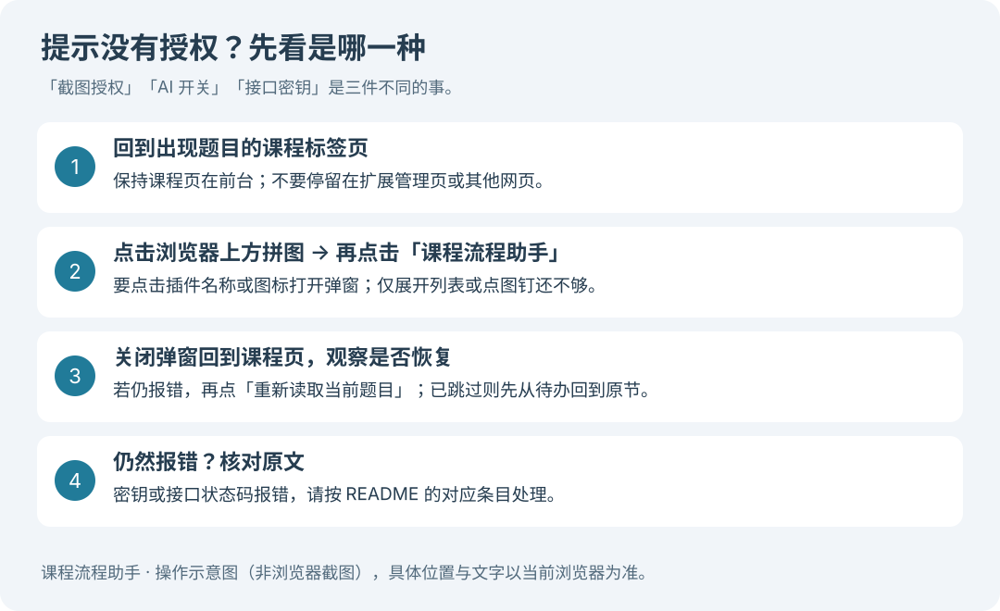

# 课程流程助手


超星学习通网页版课程助手。在课程页显示一个悬浮窗，帮助你按任务点播放视频、查看文档、切换小节，也可以按需开启 DeepSeek AI 识题。

**第一次使用？按下面顺序操作即可：下载并解压 → 按浏览器安装 → 打开课程 → 设置答题方式 → 点击开始。普通用户不需要安装 Node.js，也不用运行任何命令。**

[下载最新版本](https://github.com/wohuihaohaoaini/course-runner-extension/releases/latest) · [反馈问题](https://github.com/wohuihaohaoaini/course-runner-extension/issues) · [版本更新记录](CHANGELOG.md)

> 本教程对应 **1.0.1** 的界面与功能。下载时以 Releases 发布页的最新版本为准。支持桌面版 Chrome（内核 111 及以上）和基于 Chromium 的 Edge；建议使用浏览器当前稳定版。手机学习通 App、手机浏览器、Firefox 和 Safari 不适用本教程。

## 目录

- [插件能做什么](#插件能做什么)
- [第一步：下载和解压](#第一步下载和解压)
- [第二步：安装插件（按浏览器二选一）](#第二步安装插件按浏览器二选一)
  - [Chrome 安装教程](#chrome-安装教程)
  - [Edge 安装教程](#edge-安装教程)
- [第三步：第一次开始学习](#第三步第一次开始学习)
- [第四步：选择答题方式](#第四步选择答题方式)
- [提示没有答题授权怎么办](#提示没有答题授权怎么办)
- [常见问题与处理办法](#常见问题与处理办法)
- [如何更新或卸载](#如何更新或卸载)
- [问题仍未解决：导出日志并反馈](#问题仍未解决导出日志并反馈)
- [数据与隐私](#数据与隐私)
- [开发与验证](#开发与验证)

## 插件能做什么

| 内容 | 插件的处理方式 | 你需要留意的地方 |
| --- | --- | --- |
| 视频、音频 | 按任务点顺序正常播放 | 保持课程标签页在前台，不最小化浏览器 |
| 文档 | 滚动至底部 | 是否完成，以学习通实际显示为准 |
| 自动换节 | 默认进入下一个未完成小节 | 可以改为做完一节后停下 |
| 视频弹题 | 可选 AI 作答、单选顺序试答、手动作答 | 顺序试答仅支持可重选的 2–4 项单选题 |
| 章节测验 | 可选 AI 识题与填写 | 默认不自动提交，需本人核对 |
| 暂时无法处理的任务 | 记入“待你处理” | 跳过不代表完成，需要回访补做 |
| 验证码、人脸识别 | 等待本人处理 | 必须由你完成验证 |

插件不倍速、不拖动进度、不修改平台完成标记。使用前请确认符合学校及平台规定；AI 答案可能出错，请核对后提交。

下图为当前插件在**匿名模拟课程**中的界面截图，不涉及真实账号或课程数据。



## 第一步：下载和解压

1. 打开 [最新版本下载页](https://github.com/wohuihaohaoaini/course-runner-extension/releases/latest)。如果无法直接打开，进入仓库首页，找到 **Releases**（发布版本）再进入。
2. 找到 **Assets**（附件；有时需要点击展开），下载名为 `course-runner-extension-版本号.zip` 的安装包，例如 `course-runner-extension-1.0.1.zip`。优先下载这个包，避免与页面自带的 `Source code (zip)` 源码包混淆。
3. 下载后**先解压**。Windows 通常可以右键 ZIP →“全部解压缩”；macOS 通常双击即可解压。
4. 把解压后的文件夹放到固定位置，例如“文档 → 我的插件 → 课程流程助手”。安装后不要删除或移动这个文件夹。
5. 打开文件夹，确认能直接看到 `manifest.json`。

**浏览器要选的是下面这一层文件夹，不是 ZIP 压缩包，也不是 `manifest.json` 文件本身：**

```text
课程流程助手/           ← 安装时选这个文件夹
├── manifest.json       ← 打开文件夹后直接能看到它
├── background.js
├── popup.html
├── content/
└── icons/
```

如果解压后还有一个同名子文件夹，继续打开，直到看到 `manifest.json`。如果发布页暂无安装包，也可以从仓库的 **Code → Download ZIP** 下载源码，解压后同样选择直接包含 `manifest.json` 的目录。

> 以前装过旧版？先到扩展管理页将旧版停用，避免两套插件同时操作课程页。确认新版本正常后，再移除旧版。

## 第二步：安装插件（按浏览器二选一）

根据你使用的浏览器，选择下面对应的一种安装方式即可，完成后继续第三步。

### Chrome 安装教程



*上图为操作示意，不是 Chrome 实际截图。不同版本的文字或按钮位置可能略有变化。*

1. 打开 **Google Chrome**。
2. 将 `chrome://extensions` 复制到浏览器顶部的**地址栏**，按回车。不要输入到网页中间的搜索框。
3. 打开页面通常位于**右上角**的“开发者模式”。
4. 点击“**加载已解压的扩展程序**”（英文界面为 **Load unpacked**）。
5. 在文件选择窗口中，选中刚才解压的、直接包含 `manifest.json` 的**文件夹**，点击“选择文件夹”或“打开”。
6. 页面出现“**课程流程助手**”卡片，且启用开关已打开，就说明已经加载。
7. 点击地址栏右侧的“扩展程序”拼图图标，找到“课程流程助手”，点旁边的**图钉**，把它固定到工具栏。
8. 回到已打开的学习通课程页，**刷新一次页面**。

**安装成功的检查方法：**在课程学习页能看到悬浮窗；点击工具栏里的插件图标，能看到“开始”“运行设置”“AI 识题”等内容。

安装步骤可对照 [Chrome 官方加载说明](https://developer.chrome.com/docs/extensions/get-started/tutorial/hello-world#load-unpacked)。

### Edge 安装教程

这里指微软 **Microsoft Edge** 浏览器。



*上图为操作示意，不是 Edge 实际截图。步骤按微软官方本地加载流程整理；当前文档未宣称已在本机完成 Edge 全流程实测。*

1. 打开 **Microsoft Edge**。
2. 将 `edge://extensions` 复制到浏览器顶部的**地址栏**，按回车。
3. 找到“**开发人员模式**”（也可能显示为“开发者模式”），通常在**左侧栏下方**，将它打开。如果窗口太窄没有显示侧栏，先展开侧栏或页面菜单。
4. 点击“**加载解压缩的扩展**”（有些版本叫“加载已解压的扩展程序”；英文为 **Load unpacked**）。
5. 选中直接包含 `manifest.json` 的**文件夹**，点击“选择文件夹”或“打开”。
6. 页面出现“**课程流程助手**”卡片，检查它处于启用状态。
7. 点击地址栏右侧的扩展程序图标，找到本插件，选择**在工具栏中显示**，或使用当前版本提供的固定按钮。
8. 回到学习通课程页，**刷新一次页面**。

**注意：**本教程使用“加载解压缩的扩展”安装本地文件；“允许来自其他应用商店的扩展”不是这一步的替代开关。如果设备由学校或公司管理，开发人员模式可能受管理策略限制，请联系设备管理员。

安装步骤可对照 [Edge 官方本地加载说明](https://learn.microsoft.com/en-us/microsoft-edge/extensions/getting-started/extension-sideloading)。

## 第三步：第一次开始学习

在 Chrome 或 Edge 中安装完成后，使用方法相同。

1. 登录你平时使用的学习通网页版，从课程入口进入**章节目录**。
2. 点击需要学习的小节，进入有视频、文档或章节测验的**课程学习页**。插件匹配 `https://*.chaoxing.com/*`，仅打开学校门户或学习通首页不等于进入学习页。
3. 确认页面有“课程流程助手”悬浮窗。没有的话，先刷新课程页，并按下方常见问题排查。
4. 点击浏览器工具栏里的插件图标，展开“**运行设置**”，按需调整：

   | 设置 | 新手如何选择 |
   | --- | --- |
   | 做完一节后 | 想继续学习就选“自动进入下一个未完成小节”；想自己换节就选“停下，等我自己换节” |
   | AI 关闭时遇到章节测验 | 想稍后补做就选“先跳过，记进‘待你处理’”；想现场自己做就选“停下等我做完再继续” |
   | 视频弹题处理 | 按下一节说明，选择手动、顺序试答或 AI |
   | 需要我处理时发桌面通知 | 按需开启；浏览器和系统也需要允许通知 |

5. 回到课程页，在悬浮窗点击“**开始**”。运行时需要停下，可点击“**暂停**”。
6. 保持课程标签页在前台。不要最小化浏览器，尤其在截图识题时不要切换标签页。
7. 结束后展开“**待你处理**”，查看未完成原因，点击条目回到对应小节补做，最后核对学习通的任务点标记。

悬浮窗挡住画面时，可以按住标题栏拖动；需要安静播放时，可点“静音”，或使用 `Alt+M`。快捷键冲突时，在 Chrome 的 `chrome://extensions/shortcuts` 或 Edge 的 `edge://extensions/shortcuts` 中修改。

## 第四步：选择答题方式

### 方式一：自己答题，不使用 AI

1. 点击工具栏插件图标 →“运行设置”。
2. 将“视频弹题处理”改为“**手动作答**”。
3. AI 总开关保持关闭。遇到视频题目时由你作答；按页面提示继续播放。
4. 章节测验按“先跳过”或“停下等我”的设置处理。

这种方式不需要接口密钥，也不消耗 AI 接口额度。

### 方式二：视频单选顺序试答，不使用 AI

在“运行设置”→“视频弹题处理”选择“**单选顺序试答 A → B → C → D（无需 AI）**”。

此模式无需填写密钥，也无需打开 AI 总开关。它只处理**平台允许重选的 2–4 项视频单选题**，每个选项最多尝试一次，并根据页面本次反馈判断是否继续。不能重选、强制回看、选项耗尽或反馈无法确认时，会记入待办。多选题、判断题及其他题型需要 AI 或人工处理；章节测验不使用顺序试答。

### 方式三：开启 DeepSeek AI

下图直接来自本插件设置页，使用匿名测试环境生成。图中没有真实密钥；示例选择仅用于展示界面，实际请按以下步骤配置。



**先理解“接口密钥”：**它是 AI 服务提供的 API Key，用于让插件调用接口。它不是学习通密码，也不是 DeepSeek 网页版的登录密码。插件不提供共享密钥。

1. 准备你自己的 DeepSeek 接口密钥。请通过 [DeepSeek 开放平台](https://platform.deepseek.com/) 的官方入口查看 API Key 和账户可用额度；平台页面以当时实际显示为准。
2. 回到**课程标签页**，点击工具栏里的“课程流程助手”图标。
3. 展开“**AI 识题**”，在“**DeepSeek 接口密钥**”中粘贴密钥，点击旁边的“**保存**”。看到“接口密钥已保存到本机”才表示保存成功。重新打开后输入框通常显示“已保存（输入新值可替换）”，不会直接展示完整密钥。
4. 勾选“**开启 AI 识题（总开关）**”。
5. 根据需要勾选“视频弹题 AI”及“章节测验：AI 识题与填写”。只开总开关、关闭对应分项，该分项不会启用 AI。
6. 如果要用 AI 处理**视频弹题**，还需要在“运行设置”中将“视频弹题处理”选为“**AI 作答（需开启 AI）**”。
7. 第一次使用建议保持“**自动提交章节测验**”不勾选。插件填写后由你检查，再手动提交。视频弹题 AI 的提交不受这个章节测验开关控制。
8. 关闭设置弹窗，回到悬浮窗点击“开始”。之前已报错的题目，可按下一节方法重新读取。

文字识题模型可在下拉框选择；当前版本默认 Flash，图像题固定使用 Flash。这里描述的是插件 1.0.1 的配置，实际模型是否可用以接口响应为准。“课程资料”和“自定义提示词”均为可选项，分别需要点击对应的保存按钮。

**开关类设置选中后自动保存；密钥、课程资料、自定义提示词需要点击各自的“保存”按钮。**

## 提示没有答题授权怎么办

用户口中的“没有答题授权”可能指几种不同问题。请先看完整报错，找到下面对应的一项，避免反复重装插件。

### A. 显示截图答题无法进行、“需要截图授权”或包含 activeTab / permission / denied

插件遇到图片题、加密字体题等需要截图识别的内容时，可能出现：

> 需要截图授权：点击浏览器工具栏的扩展图标授权，再在悬浮窗点击“重新读取当前题目”。跨站跳转后可能需要重新授权



**最直接的处理方法（Chrome 和 Edge 都一样）：**

**回到课程页 → 点击浏览器上方的拼图（扩展程序／插件按钮）→ 点击“课程流程助手”（本刷题插件）。**

这次点击就是给当前课程页截图授权的关键操作。通常不需要再寻找单独的“答题授权”开关，也不会弹出“授权成功”窗口。

1. 保持**出现题目的课程标签页**在前台。
2. 点击浏览器上方的**拼图图标**，在列表中点击“**课程流程助手**”的名称或图标，打开插件弹窗。已经固定插件图标的，也可以直接点击它。
3. 关闭弹窗，回到课程页观察是否恢复。若仍停留在原来的错误状态，再点击悬浮窗里的“**重新读取当前题目**”。

**只点拼图展开列表、只点图钉固定插件，都还不够；要再点一下列表里的“课程流程助手”。**

如果插件已经跳到了下一节，先从“待你处理”回到原小节，再点击工具栏图标并重试。如果没有“重新读取当前题目”按钮，先确认当前题目已经加载且任务已开始；仍未出现时可以本人作答。跨站跳转或重新打开课程标签页后，可能需要再点一次图标。

### B. 显示 AI 关闭，或选择 AI 作答后没有反应

打开插件设置，逐项检查：

- “开启 AI 识题（总开关）”已勾选。
- 要处理视频题，勾选“视频弹题 AI”，并将“视频弹题处理”选为“AI 作答”。
- 要处理章节测验，勾选“章节测验：AI 识题与填写”。
- 已保存自己的接口密钥。

### C. 显示“请填写答题接口密钥”或“请填写接口密钥”

到“AI 识题”填写自己的 DeepSeek API Key，点击“保存”。只把密钥粘贴进输入框、没有点击保存，插件仍无法使用它。

### D. 显示“答题接口请求失败，状态码 401 / 402 / 403”等

这是接口返回的问题，**点击工具栏图标不能解决密钥、余额或账户限制**。按下一节的状态码表检查。不要把密钥发给别人“代授权”。

## 常见问题与处理办法

### 1. 安装时提示“清单文件缺失或不可读”

通常选错了文件夹。重新解压 ZIP，打开文件夹，找到直接包含 `manifest.json` 的那一层，再加载**这一层文件夹**。如果文件确实缺失，重新下载完整安装包，不要自行创建一个空的 `manifest.json`。

### 2. 没有“加载已解压”按钮

先打开扩展管理页里的开发者／开发人员模式。Chrome 通常在右上角，Edge 通常在左侧栏下方。窗口太窄时先展开菜单。如果开关被管理策略禁用，需要联系设备管理员。

### 3. 安装后课程页没有悬浮窗

依次检查：

1. 扩展管理页里“课程流程助手”处于启用状态，且没有同时启用多个旧版。
2. 当前是 `https://` 开头、域名以 `.chaoxing.com` 结尾的课程学习页，已经从课程目录进入小节。
3. 安装或更新后刷新了课程页。仍不出现时，关闭旧课程标签页，从正常课程入口重新进入。
4. 在插件详情中检查网站访问权限是否允许它在学习通站点运行（若浏览器提供该设置）。
5. 检查扩展卡片有无错误；有的话保存完整报错并反馈。

### 4. 显示“扩展与课程页连接已断开”

常见于刚安装、重新加载或更新插件后。刷新**课程标签页**，再打开插件并点击“开始”。不要只刷新扩展管理页。仍不行时关闭旧课程页，从课程入口重新进入。

### 5. AI 请求失败或一直识别不出来

以下是常见排查方向，**最终以完整错误内容及 DeepSeek 官方账户状态为准**：

| 提示／状态码 | 可以怎么处理 |
| --- | --- |
| 400 | 检查完整报错，可能是请求参数或模型不兼容；确认使用当前插件版本，持续出现则导出日志反馈 |
| 401 | 密钥无效或认证失败；重新复制有效 API Key 并保存 |
| 402 | 常见为可用余额不足；到官方平台查看账户状态 |
| 403 | 可能是账户或访问限制；核对官方平台提示，必要时联系服务方 |
| 404 | 检查模型是否仍可用、插件是否需要更新 |
| 429 | 请求受限；稍等后再试，避免多个课程页同时调用接口 |
| 5xx | 服务端暂时异常；稍后重试 |
| “答题接口连接失败”或超时 | 检查网络，确认能够访问接口服务后重试 |
| “课程标签页不在前台，无法截图” | 回到课程标签页，不最小化，识别期间不要切换页面 |
| “题型暂不支持”“答案数量不匹配”“核对失败” | 不要强行提交，人工检查并处理，必要时反馈 |
| “运行或 AI 设置已变化，旧结果已失效” | 当前任务或设置发生变化；确认设置后，在当前题目重新读取 |

章节测验在符合重试条件时，会分别等待 **5 秒、15 秒、30 秒**进行最多三次自动重试；缺少密钥、未授权截图、接口 400–404 或题型不支持等情况不会靠自动重试解决。视频弹题 AI 失败可能直接记入待办并换节，请回访处理。

### 6. AI 已填好章节测验，为什么没有提交

默认只填写，等待你核对后自己提交。这是正常行为。确实需要自动提交时，才单独勾选“自动提交章节测验”。已提交的内容无法通过关闭 AI 开关撤回。

### 7. 视频没有播放，或播放卡住后自动换节

先在课程页手动点击一次播放，确认视频本身能正常播放，再检查网络和页面提示。插件初次播放等待超过约 25 秒、反复播放仍暂停或超过约 45 秒没有进度时，可能记为待办并换节。

**自动换节不表示视频已完成。**请从“待你处理”回到该节补做，并核对平台标记。若只想学习当前小节，可把“做完一节后”设为“停下，等我自己换节”。

### 8. 下一节打不开，提示需要完成前面的内容

课程可能启用了闯关或前置任务限制。回到上一节，补完视频、文档或测验，确认平台已标记完成后再进入下一节。插件无法解除平台锁定。

### 9. 出现验证码或人脸识别

由本人按平台提示完成验证。插件会等待，不会自动绕过。完成后观察悬浮窗状态；若已暂停，再点击“开始”。

### 10. “待你处理”有内容，但插件显示已结束

表示本轮流程已结束，不代表所有任务点都完成。展开清单查看原因，点击条目回访补做。“清空清单”只删除本机待办记录，不会替你完成课程任务。

### 11. 浏览器重启后插件不可用

到扩展管理页检查是否被停用、原解压文件夹是否仍在。文件夹被移动或删除时，恢复文件夹后重新加载；找不回时重新下载并安装。浏览器若提示开发者模式扩展，请核对确实是自己安装的本插件，再决定是否保留启用。

### 12. 收不到通知，或静音快捷键无效

桌面通知需同时检查插件通知开关、浏览器系统通知权限与系统勿扰模式。快捷键可在浏览器的扩展快捷键页修改；也可直接点击插件里的“静音”按钮。

## 如何更新或卸载

### 更新：保留原插件条目

开发者模式加载的本地文件通常需要你手动更新。

1. 暂停任务，下载新版本 ZIP 并解压到临时位置。
2. 备份原文件夹，将新版本运行文件完整替换到**原来加载的同一路径**，避免新旧文件混杂。
3. 打开 Chrome 的 `chrome://extensions` 或 Edge 的 `edge://extensions`，找到“课程流程助手”，点击卡片上的**重新加载／刷新图标**。
4. 检查卡片版本号，再刷新课程页。
5. 确认设置和密钥保存状态；需要截图识题时，在课程页重新点击工具栏插件图标。

如果改用一个新的文件夹加载，先停用旧条目。新条目可能需要重新配置，确认正常后再移除旧条目。卸载旧插件可能清除其本地设置，请先记下所需配置；不要为了备份把密钥写进公开文档。

### 卸载

在对应浏览器的扩展管理页找到“课程流程助手”，点击“移除”。移除后可删除本地解压文件夹。仅想停用时，关闭扩展卡片的启用开关即可。

## 问题仍未解决：导出日志并反馈

1. 保持发生问题的课程页打开，尽量在问题出现后立即操作。
2. 点击工具栏里的插件图标，滚动到下方，点击“**导出日志**”。
3. 浏览器会下载类似 `course-runner-log-2026-10-18.json` 的文件。
4. 打开 [GitHub Issues](https://github.com/wohuihaohaoaini/course-runner-extension/issues)，点击 **New issue**（需要登录 GitHub），附上日志与以下信息。

可以直接复制这个模板填写：

```text
插件版本：例如 1.0.1
浏览器及版本：Chrome / Edge，具体版本号
操作系统：Windows / macOS，具体版本
发生位置：视频播放 / 视频弹题 / 章节测验 / 安装 / 其他
视频答题模式：AI / 顺序试答 / 手动
AI 开关：总开关、视频分项、测验分项各自是否开启
报错原文：
复现步骤：
1.
2.
预期会发生什么：
实际发生了什么：
已尝试的处理：
附件：诊断日志、打码后的报错截图
```

诊断日志设计上不包含题干、答案、截图和接口密钥。**上传前仍请自行查看附件**，对截图中的姓名、学号、头像、课程链接参数及其他个人信息打码；不要公开 API Key 或账号密码。若怀疑密钥泄露，请到服务方平台撤销旧密钥，再创建新密钥。

## 数据与隐私

- 接口密钥保存在当前浏览器的本地扩展存储中，不会因此自动同步到另一台设备。可在“AI 识题”中点击“删除本机密钥”。
- 开启 AI 后，当前题目、必要截图和相关课程资料会发送给 DeepSeek，并使用你自己的接口额度。请只填写愿意提供给该服务的资料。
- 浏览器的截图授权允许插件截取当前标签页可见区域；使用识题时请避免让个人信息或其他敏感内容出现在该区域。
- AI 关闭后不使用 AI 识题；不使用 AI 的视频单选顺序试答仍可按所选模式独立运行。
- 本插件请求学习通站点及 DeepSeek 接口的访问权限；截图识题使用临时的 `activeTab` 授权，这也是为什么需要在课程页主动点击工具栏图标。

## 开发与验证

普通用户可以跳过本节。开发者在仓库目录使用 Node.js 22 或以上版本：

```bash
npm install
npm test
```

浏览器界面验证脚本见 `tests/e2e/`，使用 Playwright 与匿名模拟课程；运行前需准备匹配的 Chromium。可用 `npm run test:panel` 验证悬浮窗与设置页，其他脚本见 `package.json`。

README 配图保存在 `docs/images/`：两张 PNG 为当前插件在匿名模拟环境中的真实界面截图；三张 SVG 为人工编排的操作示意，浏览器具体界面以实际版本为准。

发布新版本时，同步更新 `manifest.json`、`package.json` 与 `CHANGELOG.md`，打版本标签并上传安装包。本地源码与发布包的安装流程均不要求普通用户运行 npm。

## 使用说明

本项目仅供学习与研究浏览器扩展开发使用。使用前请确认符合所在学校与平台规定，使用后果由使用者自行承担。学习进度和提交结果始终以平台实际记录为准。
